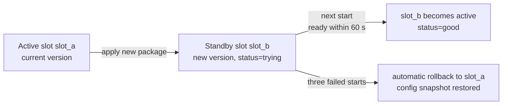

# Installing & Upgrading the Robot System

The software running on the robot host (the **robot system** below) provides the control plane; the SDK is only a client of it. This page covers installing, upgrading, rolling back and uninstalling the robot system. For parameters see [Configuring the Robot System](./robot-system-config.md); for day-to-day operations commands and the local console see [Robot System Operations & Local Console](../../usage/testing/robot-system.md).

## How it relates to the SDK

The robot system and the SDK ship under **one product version number** and are meant to be paired — see [Version Compatibility](./compatibility.md):

| Component | Runs on | How it is installed |
|-----------|---------|---------------------|
| Robot system (`fabot` command, control plane, capabilities, skills and platform services) | The robot host | Release zip plus `fabot-install.sh`, i.e. this page |
| SDK (`fabot-sdk`, import name `fabot`) | Your application process | See [Installing the Python SDK](./python.md) |

The robot-system release also carries the matching SDK wheel, so on the robot host `fabot sdk` installs it into your own environment without hunting for a package.

## When you install it yourself

The robot system usually ships with the robot: installed at the factory or during delivery and already configured for the machine model. Only these cases need you to touch the robot host:

- reinstalling the whole-robot software, or upgrading a field robot to a new version;
- building your own test machine, spare machine, or simulation host;
- recovery after a system disk replacement or corruption.

Writing applications and calling capabilities against an existing robot does not require installing the robot system.

## Prerequisites

| Item | Requirement |
|------|-------------|
| Operating system | Ubuntu 24.04 (the release baseline) |
| CPU architecture | amd64 or arm64; the installer picks the package for this machine |
| Privileges | root (installation and uninstall write the product root and systemd units) |
| Service management | systemd |
| Other | `python3` on the target; the release carries its runtime, so **no** build toolchain, ROS development environment, or network is needed |

:::warning Install only on the robot host
The release is whole-robot software, not a library for the application side. To install the SDK on an application machine, see [Installing the Python SDK](./python.md).
:::

## What the release contains

The deliverable is a zip named by version and architecture. Unpacked, the same level holds:

| Path | Contents |
|------|----------|
| `fabot-install.sh` | One-shot installer; picks the package for this architecture |
| `fabot-uninstall.sh` | One-shot uninstaller |
| `boot/` | Bootstrap binaries, boot state, systemd units, command wrappers and the verification key |
| `fpkg/` | Whole-system packages the installer selects from |

The whole-system package is `fabot-system-full_<version>_<arch>.fpkg`. On a machine that already has an active slot you can also apply an incremental package (`fabot-system-lite` or an update package): the former is the in-repo system unit, the latter carries only the modules that changed.

Packages are signed; installation verifies the signature, architecture, and dependency closure. Unsigned packages are for local packaging tests only — do not install them in the field.

### Getting the release

Release zips, SDK wheels and motion-control packages are published on the software delivery portal, listed by version and channel (release / debug):

- Download page: [robot system & SDK packages](https://app.five-ages.ai/downloads#p=0eec0050-0430-4e36-acb4-627be7bdd6ed) (also the same entry in the top-bar **Download** menu)
- For a field deployment, pick the entry whose architecture matches the robot and the version you are targeting;
- The SDK wheel (`fabot_sdk-<version>-py3-none-any.whl`) is listed there too; take it from that list when you need to hand it to an application machine separately, see [Installing the Python SDK](./python.md).

The zip needs no renaming: the installer recognizes version and architecture from the file name, so just unpack it.

## Install

Unpack the release zip, enter the unpacked directory, and run the installer:

```console
$ unzip fabot-system-full_1.1.0_amd64.zip
$ cd fabot-system-full_1.1.0_amd64
$ sudo ./fabot-install.sh
```

The script first installs the boot layer (creates the product root, registers `fabot.service` and `fabot-console.service`), then applies the whole-system package, and finally prints `install complete`.

| Option | Effect |
|--------|--------|
| `--version <version>` | Pick a version when `fpkg/` holds more than one; otherwise the script fails and asks for one |
| `--arch amd64\|arm64` | Force the architecture; the host is inspected by default |
| `--fpkg <path>` | Apply explicit package files and skip automatic selection |
| `--dry-run` | Print the architecture, version and package paths without changing anything |
| `--hot` | Write the active slot directly and keep a rollback file; skips the standby-slot trial. Use only when an in-place update is required |

Two environment variables affect the install:

- `FABOT_ROOT`: the product root, `/opt/fiveages/fabot` by default. The installer writes it into the systemd units, so set a non-default value before installing and keep it consistent afterwards.
- `FABOT_BOOT_ALLOW_UNPRIVILEGED=1`: allow a non-root install. Only for development machines; the wrappers land under `$FABOT_ROOT/boot/wrappers` instead of system directories.

Run `--dry-run` first to confirm which package will be used:

```console
$ sudo ./fabot-install.sh --dry-run
arch=amd64
version=1.1.0
apply=.../fpkg/fabot-system-full_1.1.0_amd64.fpkg
```

## First start

The installer **does not** start the service and does not enable boot-time start. After installing:

```console
$ fabot status          # version, active slot, unit state, config overlays, listening ports
$ fabot doctor          # item-by-item checks; exits 1 with a repair command when any check fails
$ fabot start           # start fabot.service
$ fabot enable          # only if boot-time start is wanted
```

`fabot status` and `fabot doctor` are read-only and work while the system is down. After the first start the control-plane port should be listening; if it is not, see [Troubleshooting](../../troubleshooting.md).

The local console is a separate unit and is also left disabled; start it with `fabot console start`, see [Robot System Operations & Local Console](../../usage/testing/robot-system.md).

## Upgrade

Upgrading is the same path as installing: get the new version from the [software delivery portal](https://app.five-ages.ai/downloads#p=0eec0050-0430-4e36-acb4-627be7bdd6ed) (see "Getting the release" above), unpack the release zip and run `sudo ./fabot-install.sh` again. When an active slot exists, the new package is not written over the running version — it goes into the **standby slot** and the boot state becomes `trying`, to be tried on the next start.



The upgrade sequence:

```console
$ sudo ./fabot-install.sh        # write the standby slot
$ fabot restart                  # restart fabot.service to try the new slot
$ fabot version                  # confirm version and active slot switched
$ fabot status                   # confirm unit, ports and configuration
```

The trial runs on the next start of `fabot.service`, so restart (or reboot) after applying. The boot layer waits for the control plane: when it becomes ready the new slot is marked `good`; on timeout or failure it retries, and after three failed starts it rolls back automatically to the last known good slot and restores the pre-upgrade user configuration snapshot.

### Inspect and roll back manually

```console
$ fabot boot status       # JSON: active_slot / standby_slot / status / tries_left / system_version
$ fabot boot rollback     # return to last_known_good_slot and restore the config snapshot
```

`fabot boot rollback` points the active slot back at the last known good slot, sets the boot state to `good`, and restores the pre-upgrade user configuration snapshot. When the active slot actually changes it also restarts the console unit. Use it to return to the previous version immediately instead of reinstalling.

### Update part of the system only

When you have a single package (not a whole-system zip), apply it directly:

```console
$ sudo fabot pkg apply /path/to/fabot-system-lite_<version>_<arch>.fpkg
```

It also writes the standby slot and sets `trying`, so it takes effect on the next start. A machine with no boot layer cannot install a single package this way — only the release zip's installer can bootstrap it.

Related read-only and cleanup commands:

| Command | Effect |
|---------|--------|
| `fabot pkg list` | Print the active slot, boot status, system version, and each module version |
| `fabot pkg gc` | Remove store leaves no slot manifest references, keeping the one rollback needs |
| `fabot pkg hot-rollback` | Undo the last `--hot` update |

### Upgrading motion control separately

The motion-control workspace is a separate deliverable and does not update with the whole-system package:

```console
$ sudo fabot motion install /path/to/fa_<model>_ws_<version>_<arch>_nogit.zip
```

Installation materializes the workspace into the module store, assembles the standby slot and sets `trying`; it also takes effect on the next start. It requires an existing active slot and no active motion overlay — motion overlays are a development feature, so clear them with `fabot motion reset` before a field upgrade. The architecture in the file name must match this machine.

## Uninstall

```console
$ sudo fabot uninstall              # on PATH after installation
$ sudo ./fabot-uninstall.sh         # equivalent script from the release directory
```

Uninstall stops and removes `fabot.service` and `fabot-console.service`, drops the command wrappers under `/usr/local/bin`, then deletes the whole product root, including user configuration, observations, caches and downloaded upgrade packages.

| Option | Effect |
|--------|--------|
| `--keep-data` | Remove the software but keep `data/config` and `data/obs` |
| `--dry-run` | Print every step as `would ...` and delete nothing |

After an uninstall with `--keep-data`, `fabot-uninstall` stays on PATH; run it again without the option to drop the residual configuration. When the product root has no install marker (`boot/bin/fabot-boot` or `.fabot-root`) the script refuses, so it cannot delete an unrelated directory.

:::note Legacy Deb packages are unrelated
Machines installed from the early Deb packages are not managed by this script; keep using their package-manager flow. Every new machine uses the release zip installer.
:::

## Directory layout

The installed product root defaults to `/opt/fiveages/fabot`:

| Path | Purpose |
|------|---------|
| `boot/` | Boot binaries, boot state and the verification key |
| `system/active` | Points at the active slot (`system/slots/slot_a` or `slot_b`) |
| `system/store/` | Versioned module content shared by both slots and used for rollback |
| `data/config/current` | User configuration (`FABOT_HOME` can move it) |
| `data/config/snapshots/` | Configuration snapshot written automatically before each upgrade |
| `data/obs/` | Observations: collector logs, freeze records, raw logs and bags |
| `data/cache/` | Runtime caches for motion control and voice |
| `data/ota/` | Upgrade downloads, staging and the operation journal |

`system/active` is a symbolic link; upgrades and rollbacks only repoint it and never touch the running slot. User configuration lives outside the slots, so changing versions does not lose it; for how the configuration structure evolves see [Configuring the Robot System](./robot-system-config.md).

## Next steps

- [Configuring the Robot System](./robot-system-config.md): config paths, ports and environment variables, first-boot setup
- [Robot System Operations & Local Console](../../usage/testing/robot-system.md): the `fabot` command and `fabot console`
- [Version Compatibility](./compatibility.md): how robot-system and SDK versions relate
- [Installing the Python SDK](./python.md): install the matching SDK into your application environment
