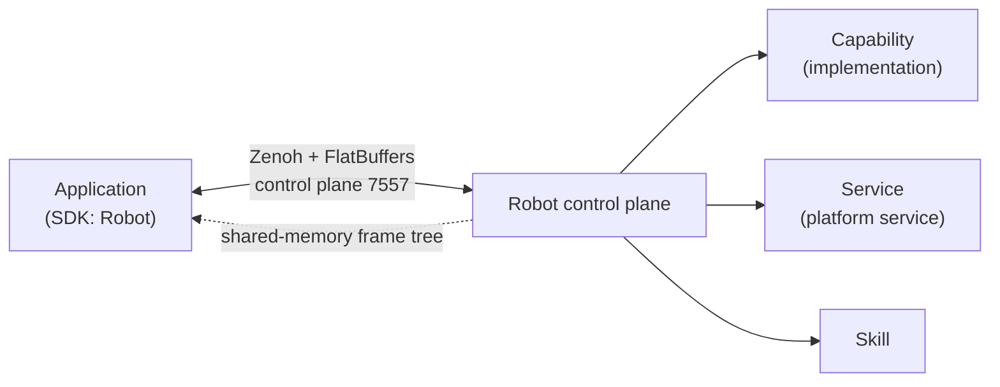

# Overview & Architecture

The fabot SDK is a Python client development kit for integrators (wheel name `fabot-sdk`, import name `fabot`) used to connect to, control and monitor a fabot robot from your application. This page covers where the SDK sits, the core concepts and the API layers; installation and version compatibility are in [Installation & Configuration](install/index.md).

## Where the SDK sits

The SDK runs inside your application process and talks to the robot control plane over Zenoh native plus FlatBuffers. It does not link ROS (`rclcpp` / `rclpy`), so it runs on any host that meets the dependencies (see [Requirements](install/requirements.md)).



A capability is a domain feature unit on the robot (chassis, arm, camera, …) installed into a slot; the SDK provides a strongly typed proxy per slot. A platform service is a resident process on the robot that the SDK can start, stop, configure and inspect, see [Platform Services](usage/services.md). A skill combines several capabilities into a higher-level semantic unit reached through `robot.skills`, see [Skills & Extensions](usage/skills.md).

## At a glance

```python
from fabot import Robot

with Robot.connect("192.168.1.10", 7557) as robot:
    robot.wait_ready()                                        # wait for bound, essential slots
    print(robot.state().mode, robot.state().health)           # run mode and health
    robot.chassis.servo_twist(vx=0.2, vy=0.0, vtheta=0.0)    # chassis velocity command
```

`Robot.connect(host, port, options=None)` connects and returns a `Robot`; `from_config` / `from_endpoint` / `from_backend` and the offline `Robot.mock()` are also available, see [Connection & Lifecycle](usage/connection.md).

## Capabilities, slots and proxies

The SDK ships typed proxies for 15 capability modules, reached through 23 slot properties on `Robot` (`robot.<slot>`). One capability can be installed in several slots (left and right arm), and each slot is an independent instance of the same API.

| Module | Slot properties | Description |
|--------|-----------------|-------------|
| Body `body` | `robot.body` | Body joints, waist pose and velocity servo → [body](reference/python/body.md) |
| Arm `arm` | `robot.left_arm` / `robot.right_arm` | Single-arm joints, end-effector poses, wrench and compliance → [arm](reference/python/arm.md) |
| Arms `arms` | `robot.arms` | Dual-arm coupling, impedance drag and synchronized motion → [arms](reference/python/arms.md) |
| Hand `hand` | `robot.left_hand` / `robot.right_hand` | Finger opening, joints and tactile arrays → [hand](reference/python/hand.md) |
| Gripper `gripper` | `robot.left_gripper` / `robot.right_gripper` | Opening, velocity / force limits and servo → [gripper](reference/python/gripper.md) |
| Head `head` | `robot.head` | Head yaw / pitch, pose motion and constraint mode → [head](reference/python/head.md) |
| Chassis `chassis` | `robot.chassis` | Velocity servo, map and station navigation, parking / locking → [chassis](reference/python/chassis.md) |
| Motion `motion` | `robot.motion` | Whole-body regime, joint / pose goals, homing and presets → [motion](reference/python/motion.md) |
| Power `power` | `robot.power_1` / `robot.power_2` | Energy, voltage, current, temperature, charging → [power](reference/python/power.md) |
| IO `io` | `robot.io` | Digital pin acquire, release and level I/O → [io](reference/python/io.md) |
| Camera `camera` | `robot.head_camera` / `robot.chest_camera` / `robot.waist_camera` / `robot.left_wrist_camera` / `robot.right_wrist_camera` | Capture, calibration, imaging control and 12 streams → [camera](reference/python/camera.md) |
| Screen `screen` | `robot.screen` | Text, image and video display → [screen](reference/python/screen.md) |
| Light `light` | `robot.light` | Strip mode, color, brightness and period → [light](reference/python/light.md) |
| Voice `voice` | `robot.voice` | Microphone capture, speaker playback, volume and wake word → [voice](reference/python/voice.md) |
| Teleop `teleop` | `robot.teleop` | Joystick teleop session start and stop → [teleop](reference/python/teleop.md) |

Every proxy also has a common surface: `slot_id`, `handle`, `events`, `health()`, `lifecycle()`, `faults()`, `ping()`, `has_adapter`, `as_adapter(...)` and config access, see [Capability Interfaces Overview](reference/python/index.md).

## Robot-wide entries

| Entry | Description |
|-------|-------------|
| `robot.estop` | Software e-stop: `engage()` / `release()` / `state()` / `is_asserted`; recovery in [Troubleshooting](troubleshooting.md) |
| `robot.events` | Robot events: `estop_changed` / `robot_state_changed` / `registry_changed` / `config_changed` / `service_state_changed` / `faults_changed`, plus wildcard `subscribe()` and `emit()`, see [Events & Data Channels](usage/events-channels.md) |
| `robot.logs` | Structured logs: live subscription, history, custom emission and freezing, see [Logs, Metrics & Observability](usage/observability.md) |
| `robot.metrics` | Metrics: subscription, SDK counter snapshots, custom gauge / counter / histogram |
| `robot.frames` | Frame queries and transforms (`lookup` / `transform` / `transform_points`) with no ROS dependency, see [Frames & Transforms](usage/frames.md) |
| `robot.services` | Platform service start / stop / restart / config / state, see [Platform Services](usage/services.md) |
| `robot.skills` | Skill entries: `camera_sync` (multi-camera sync) / `voice_aiui` (voice semantics), see [Skills & Extensions](usage/skills.md) |
| `robot.configuration` | Robot config read/write (`get()` / `apply()`), see [Configuration](usage/configuration.md) |
| `robot.connection` | Connection state query and subscription (`is_connected()` / `subscribe()`), see [Connection & Lifecycle](usage/connection.md) |
| `robot.state()` | Robot state snapshot `RobotState` (`mode` / `health` / `root_causes` / `domains`), see [Status, Faults & Lifecycle](usage/status-faults.md) |
| `robot.status()` | Aggregated status bags `RobotStatus` (power, five cameras, screen, voice) |
| `robot.faults()` | Fault snapshot aggregated per slot `RobotFaults` |
| `robot.ping()` / `robot.freeze()` | Runtime round-trip probe; freeze the observability flight recorder |
| `robot.wait_ready()` | Wait for bound, essential slots; `close()` / `with` releases the connection |

## Core terms

| Term | Meaning |
|------|---------|
| Capability | A callable domain feature unit (IO, chassis, arm, …) |
| Skill | A higher-level unit combining several capabilities (multi-camera sync, voice semantics) |
| Service | A resident robot process the SDK only manages at the lifecycle and config level |
| Command | One synchronous request/response call |
| Operation | A long-running, cancelable task (navigation, trajectories, voice capture) |
| Channel | A server-pushed data stream (camera images, joint positions) |
| Event | One message delivered by the subscription mechanism |
| Slot | A pluggable capability installation site (such as `left_arm`, `head_camera`) |
| Robot Facade | The application-facing entry `Robot` |
| QoS | Channel quality profile: `"latest"` / `"realtime"` / `"reliable"` (a string passed as `qos_profile`) |
| Status bag | A GET-only capability status snapshot that cannot be subscribed |
| Diagnostic code | A 32-bit error / fault identifier rendered by [Catalogs](usage/catalogs.md) |

## Two API layers

| Layer | API | Description |
|-------|-----|-------------|
| Product | `fabot.Robot` and capability / skill proxies | Strongly typed per slot; **use this layer day to day** |
| Core | `fabot.core.SystemClient` / `SlotHandle` | Transport-level API with raw byte payloads, for advanced use and internals |

## Sync and async

The default API is synchronous; `fabot.core.asyncio_client` offers an asyncio mirror (`SystemClient` / `SlotHandle` / `OperationHandle`).

:::warning Never call blocking APIs on the SDK I/O thread
Calling synchronous interfaces from an event callback (an SDK internal thread) raises `ClientThreadError`. Keep callbacks lightweight and move blocking work to your own thread.
:::

## Error model

Protocol failures raise subclasses of `FabotError` carrying `code` (a diagnostic code), `retryable`, `trace_id` and a local `message`; `category` is only a construction tag and is not transmitted. Subclasses cover `Timeout` / `NotFound` / `InvalidArgument` / `ResourceConflict` and friends, plus configuration, adapter and frame errors (`ConfigurationConflict` / `AdapterMismatch` / `AdapterUnbound` / the `FrameError` family). See [Error Handling](usage/errors.md). Human-facing error / log / fault / metric text comes from `Catalogs`, see [Catalogs](usage/catalogs.md) and the [Catalogs reference](reference/python/catalogs.md).

## Next steps

- [Installation & Configuration](install/index.md): requirements, installing the Python SDK, version compatibility
- [Tutorial](tutorials/python.md): run your first Python program
- [Usage](usage/index.md): connection, commands and operations, events and channels, status and faults, logs and metrics, frames, configuration, errors, catalogs, mock
- [Python API Reference](reference/python/index.md): Robot entry, catalogs, shared types and the 15 capability modules
