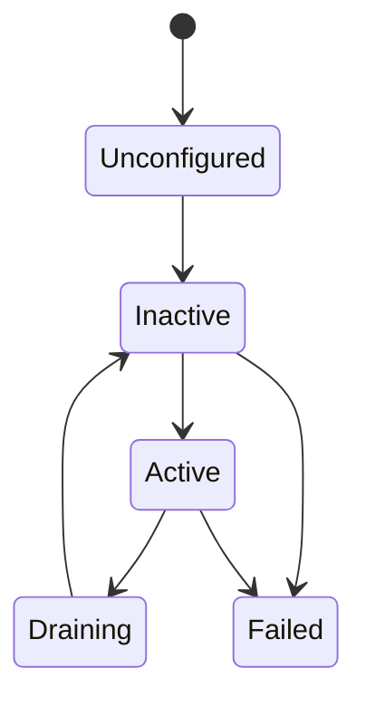

# Status, Faults & Lifecycle

The SDK exposes runtime information on three levels: **robot-wide aggregates** (`robot.state()` / `status()` / `faults()`), **capability status bags** (`robot.<slot>.status()`) and **lifecycle plus health** (each slot's `lifecycle()` / `health()`). All three are **GET-only** queries with no subscription interface; changes arrive as events, see [Events & Data Channels](events-channels.md).

## Robot-wide aggregates

| Method | Returns | Description |
|--------|---------|-------------|
| `state()` | `RobotState` | Run mode, health, root causes and per-domain health |
| `status()` | `RobotStatus` | Aggregated status bags plus `generation` / `revision` |
| `faults()` | `RobotFaults` | Fault bags aggregated per slot |
| `version()` | `str` | Robot platform version |
| `sdk_version` | `str` | SDK version (property, not a method) |

### RobotState

| Field | Type | Description |
|-------|------|-------------|
| `mode` | `RobotMode` | Run mode: `Unknown` / `Idle` / `Running` / `Estopped` |
| `health` | `HealthState` | Health: `Unknown` / `Normal` / `Degraded` / `Fault` / `Fatal` |
| `root_causes` | `list[DiagnosticReason]` | Structured root causes (`code` / `source`) when health is not `Normal`; empty otherwise |
| `domains` | `list[DomainHealth]` | Per-domain health with reasons (`domain` / `health` / `reasons`), sorted by domain key |
| `revision` | `int` | State revision |
| `timestamp_us` | `int` | Time of the last state or root-cause change in microseconds |
| `source_instance_id` | `str` | Source instance id |

Convenience properties come in two groups, one per axis:

| Run mode | Health |
|----------|--------|
| `is_running` / `is_idle` / `is_estopped` | `is_normal` / `is_degraded` / `is_fault` / `is_fatal` |

Run mode and health are independent: an e-stop only moves `mode` to `Estopped` while `health` keeps being driven by faults and power-on self-test. So "e-stopped but healthy" (`mode == Estopped and health == Normal`) is a legal combination.

Robot-state changes are pushed through `robot.events.robot_state_changed`.

```python
st = robot.state()
print(st.mode, st.health)
for cause in st.root_causes:
    print(hex(cause.code), cause.source)
for domain in st.domains:
    print(domain.domain, domain.health)
```

### RobotStatus

| Field | Type | Description |
|-------|------|-------------|
| `generation` | `int` | Status generation |
| `revision` | `int` | Status revision |
| `power_1` / `power_2` | `Status` | Power status bags, see [Power](../reference/python/power.md) |
| `head_camera` / `chest_camera` / `waist_camera` / `left_wrist_camera` / `right_wrist_camera` | `Status` | Camera status bags, see [Camera](../reference/python/camera.md) |
| `screen` | `Status` | Screen status bag, see [Screen](../reference/python/screen.md) |
| `voice` | `Status` | Voice status bag, see [Voice](../reference/python/voice.md) |

Only capabilities that implement `status()` participate; the remaining slots stay at their defaults.

## Capability status bags

Capabilities that provide `status() -> Status`:

| Capability | Status fields | Page |
|------------|---------------|------|
| `robot.power_1` / `robot.power_2` | `energy` / `current` / `voltage` / `temperature` / `is_charging` | [Power](../reference/python/power.md) |
| the five camera slots | `state` (`disconnected` / `idle` / `streaming` / `fault`) / `sync_mode` / `registration_mode` / `color_active` / `depth_active` / `infrared_active` / `imu_active` / `calibration_generation` / `temperature_c` | [Camera](../reference/python/camera.md) |
| `robot.screen` | `activity`: `Activity.Idle` / `Image` / `Video` (StrEnum) | [Screen](../reference/python/screen.md) |
| `robot.voice` | `activity`: `Activity.Idle` / `Listening` / `Speaking` (StrEnum) | [Voice](../reference/python/voice.md) |

Other modules have no `status()` and do not take part in `robot.status()` aggregation; their state comes from their own queries (for example `light.get_status()`).

Status bags are GET-only: there is no `subscribe_status`. Track changes through that capability's event stream (cameras have `camera_session_changed`).

```python
st = robot.power_1.status()
print(st.energy, st.voltage, st.is_charging)

cam = robot.head_camera.status()
print(cam.state, cam.color_active, cam.temperature_c)

act = robot.screen.status().activity
if act == "idle":   # Activity is a StrEnum and compares with strings
    ...
```

## Faults

- Robot-wide query `robot.faults() -> RobotFaults`: `revision` plus one typed fault bag per slot (`faults.chassis`, `faults.left_arm`, …); per slot use `robot.<slot>.faults()`.
- Every bag has the same shape, `Faults(revision, records: list[FaultState])`, where a `FaultState` is `code` / `source` / `state` / `severity` / `timestamp_us`. `code` is a diagnostic code and `0` means no fault.
- Fault **changes** are pushed as events: `robot.events.faults_changed` (robot-wide, payload is a `RobotFaults` organized per slot) and `robot.<slot>.events.fault_changed` (payload is that slot's `Faults`).
- Fault `code` can be localized with `Catalogs`, see [Catalogs](catalogs.md).

```python
faults = robot.faults()
for record in faults.chassis.records:
    print(hex(record.code), record.severity, record.timestamp_us)

def on_faults(event):
    print(event.header.timestamp_us, event.faults.revision)

token = robot.events.faults_changed.subscribe(on_faults)
```

:::note Event payload differs from the query result
The robot-wide `faults_changed` event carries a typed `RobotFaults` (bags per slot); the raw payload on the bus for the same event is a flat `RobotFaultSnapshot` (`revision` plus a record list). The typed entry does the organizing for you; only handle the flat form when decoding raw events yourself.
:::

## Lifecycle and health

Each slot has two read-only queries:

- `robot.<slot>.lifecycle() -> CapabilityLifecycleSnapshot`: `lifecycle` / `health` / `pbit_completed` / `source_instance_id`.
- `robot.<slot>.health() -> SlotHealth`: a product-level "is it usable now" view with `is_usable` / `lifecycle` / `health` / `standing_faults` / `pbit_completed` / `source_instance_id`.

Health folds three signals: liveliness, power-on self-test (PBIT) completion and standing faults. Until PBIT completes, `health` stays `Unknown`.

`LifecycleState` (IntEnum):

| Value | Meaning |
|-------|---------|
| `Unknown` | Unknown (not projected into a descriptor) |
| `Unconfigured` | Loaded but not configured |
| `Inactive` | Configured, not active |
| `Active` | Running normally |
| `Draining` | Draining (no new work accepted) |
| `Failed` | Failed |

`HealthState` (IntEnum): `Unknown` / `Normal` / `Degraded` / `Fault` / `Fatal`.



Transitions are driven by how the adapter actually runs; the diagram is the typical path. Trust the values from `lifecycle()` and the `lifecycle_changed` event. When lifecycle or health changes, `robot.<slot>.events.lifecycle_changed` fires with a `CapabilityLifecycleSnapshot`:

```python
def on_lifecycle(event):
    snap = event.lifecycle
    print(event.header.slot_id, snap.lifecycle.name, snap.health.name, snap.pbit_completed)

token = robot.left_arm.events.lifecycle_changed.subscribe(on_lifecycle)
```

On a slot without an adapter, `health()` / `lifecycle()` / `faults()` still work (they return an unconfigured snapshot: `health` is `Unknown`, `lifecycle` is `Unconfigured`), while `get_config()` and `as_adapter()` raise `AdapterUnbound`, and capability methods are dispatched and then fail or time out on the platform. Check `has_adapter` first.

## Related pages

- Event and log subscription mechanics: [Events & Data Channels](events-channels.md)
- Logs, metrics and flight-recorder freezing: [Logs, Metrics & Observability](observability.md)
- Localized fault text: [Catalogs](catalogs.md)
- Recovering from an e-stop: [Troubleshooting](../troubleshooting.md)
