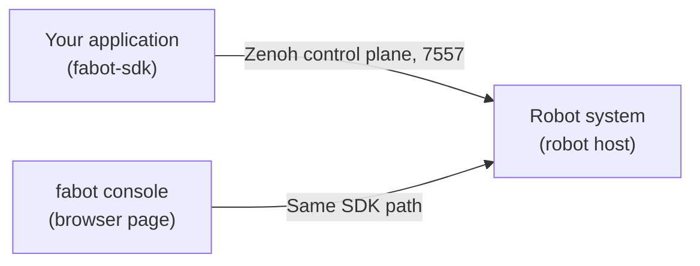

# Robot System & Local Console

This page is background: the software that runs on the robot host (the **robot system** below) provides the control plane, and the SDK is only a client of it. Application work rarely touches the robot system, but checking versions on site, starting or stopping services, or opening the console to look at state all need the handful of commands below.

## How it relates to the SDK

- The SDK (`fabot-sdk`, import name `fabot`) runs **inside your application process**; the robot system runs **on the robot host** and provides the control plane (port 7557 by default).
- `Robot.connect(...)` connects to the robot system. Capabilities, skills and platform services are all provided robot-side; the SDK gives you typed proxies on the application side.
- Both ship under **one product version number** and are meant to be paired — see [Version Compatibility](../../getting-started/install/compatibility.md).



## Usually preinstalled with the robot

The robot system usually arrives with the robot: installed at the factory or during delivery, already configured for the machine model. So:

- You generally **do not install** the robot system yourself — connect to the robot as delivered.
- Deploying, reinstalling or upgrading the whole-robot software is robot-side maintenance, done with the installer and delivery notes shipped with the release; this documentation does not cover it.
- It is managed by the systemd unit `fabot.service`. The installer alone does not enable boot-time start; whether it is enabled at delivery depends on the deployment, and `fabot status` shows the current enabled state.

## The `fabot` command

An installed robot provides one entry point, `fabot`, run on the robot host. It is for operations only and does not replace the SDK; every command has a help page (`fabot help <command>` or `fabot <command> -h`).

| Command | Purpose |
|---------|---------|
| `fabot start` / `stop` / `restart` | Start / stop / restart the robot system (`fabot.service`, i.e. the whole active slot). `stop` ends the whole process group, so SDK connections drop with it |
| `fabot status` | One summary: version, active slot, `fabot.service` active / enabled, whether config overlays are in place, and whether each port is listening. Read-only; exits 0 even when things are down |
| `fabot enable` / `disable` | Turn boot-time start of `fabot.service` on / off |
| `fabot doctor` | Check install and runtime item by item; exits 1 when any check fails and prints the command that repairs it |
| `fabot logs [-f]` | Read the `fabot.service` journal |
| `fabot version` | Print the product root, architecture, active slot, version, and the program each command resolves to |
| `fabot console ...` | The local console, see below |

`start` / `stop` / `restart` / `enable` / `disable` go through systemd. When the current user is not root, the command says what it is about to change and then lets `sudo` ask for the password.

A typical first check on a new robot:

```console
$ fabot status          # version, unit state, listening ports
$ fabot doctor          # item-by-item health, fails carry the fix
$ fabot logs -f         # follow the journal through startup
```

Values follow the live system, so no fixed sample output is shown here.

## `fabot console`

`fabot console` is the **local web console** that ships with the robot system. Open the robot's address in a browser; no extra client is needed.

- It listens on `0.0.0.0:8787` by default, so the page is at `http://<robot address>:8787/`. When that port is taken it falls forward to the next free one and says so in the startup output.
- The top bar has six pages: Robot, Frames, Modules, Checks, Troubleshooting and Playground. The Robot page shows version, run mode, connection state, camera bindings and the fault summary; Modules puts capabilities, skills, services and environments on one page; Playground wires SDK calls into a flow that runs against mock or the live robot.
- The console is itself an SDK application: it connects to the local control plane through `Robot.from_config()`. That is why the page still loads when the robot system is down — it just reports that it is not connected.


*Captured from a development environment; model, version, camera bindings and similar fields follow the deployment.*

### Controlling the console

| Command | Purpose |
|---------|---------|
| `fabot console start` / `stop` / `restart` | Start / stop / restart `fabot-console.service`; `start` and `restart` print the access URLs once the port is listening |
| `fabot console status` | Print active / enabled, the port number and the port state; lists URLs when listening |
| `fabot console enable` / `disable` | Turn boot-time start on / off (off after install) |
| `fabot console` | Serve the page in the foreground, without the unit |
| `fabot console --bind HOST:PORT` | Set the foreground listen address; `0.0.0.0:8787` by default |

A few easy confusions:

- `fabot console stop` stops `fabot-console.service` only. A console started in the foreground with `fabot console` is a different process — end it with Ctrl-C.
- The console unit does not depend on `fabot.service`: restarting the robot system leaves the console running, and a console started first simply shows "not connected".
- The console is a human-facing operations page. To read the same state from an application, use the SDK: `robot.state()`, `robot.faults()`, `robot.logs` and friends, see [Status, Faults & Lifecycle](../data/status-faults.md) and [Logs, Metrics & Observability](../diagnostics/observability.md).

## Related pages

- [Version Compatibility](../../getting-started/install/compatibility.md): why the SDK and the robot system must match
- [Connection & Robot Entry](../basics/connection.md): `Robot.connect` and endpoint selection
- [Troubleshooting](../../troubleshooting.md): cannot connect, `wait_ready` timeouts
