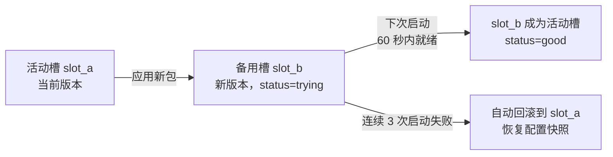

# 机器人系统安装与升级

机器人主机上运行的那套软件（下称**机器人系统**）提供控制面，SDK 只是连到它的客户端。本页说明机器人系统交付物的安装、升级、回滚与卸载；参数配置见 [机器人系统配置](./robot-system-config.md)，日常运维命令与本地控制台见 [机器人系统运维与本地控制台](../../usage/testing/robot-system.md)。

## 与 SDK 的关系

机器人系统与 SDK 按**同一套产品版本号**发布，配套使用，见 [版本配套](./compatibility.md)：

| 组件 | 跑在哪 | 怎么装 |
|------|--------|--------|
| 机器人系统（`fabot` 命令、控制面、能力、技能与平台服务） | 机器人主机 | 发行 zip + `fabot-install.sh`，即本页 |
| SDK（`fabot-sdk`，导入名 `fabot`） | 你的应用进程 | 见 [安装 Python SDK](./python.md) |

机器人系统交付物里同时带有同版本的 SDK wheel，机器人主机上可以用 `fabot sdk` 把它装进你的环境，不需要另外找包。

## 什么时候需要自己安装

机器人系统通常随机器人交付：出厂或交付时已装好，并已按机型配置。以下情况才需要在机器人主机上动手：

- 重装整机软件，或把现场机器人升级到新版本；
- 自行搭建测试机、备机或仿真主机；
- 系统盘更换、系统损坏后的恢复。

只是写应用、连机器人调能力，不需要安装机器人系统。

## 安装前提

| 项 | 要求 |
|----|------|
| 操作系统 | Ubuntu 24.04（与产品版本基线一致） |
| CPU 架构 | amd64 或 arm64，安装脚本按本机架构选包 |
| 权限 | root（安装与卸载都要写产品根和 systemd 单元） |
| 服务管理 | systemd |
| 其他 | 目标机自带 `python3`；发行包已带运行时，**不需要**编译工具链、ROS 开发环境或网络 |

:::warning 只在机器人主机上安装
发行物是整机软件，不是给应用侧用的库。应用机上装 SDK 请走 [安装 Python SDK](./python.md)。
:::

## 发行物内容

交付物是一个按版本和架构命名的 zip，解压后同级目录里是：

| 路径 | 内容 |
|------|------|
| `fabot-install.sh` | 一键安装脚本，按本机架构选包并安装 |
| `fabot-uninstall.sh` | 一键卸载脚本 |
| `boot/` | 引导程序、启动状态、systemd 单元、命令包装脚本与校验公钥 |
| `fpkg/` | 整机安装包，安装脚本从这里挑本机架构的包 |

整机包是 `fabot-system-full_<版本>_<架构>.fpkg`。已有活动槽的机器上也可以只应用增量包（`fabot-system-lite` 或更新包）：前者是仓库内模块组成的系统单元，后者只带本次变化的模块。

发行包带签名，安装时校验签名、架构与依赖闭包。未签名的包只能用于本地打包测试，不要装机使用。

### 获取发行物

发行 zip、SDK wheel 与运控交付包都在软件交付平台发布，按版本和通道（正式 / 调试）列出：

- 下载页：[机器人系统与 SDK 安装包](https://app.five-ages.ai/downloads#p=0eec0050-0430-4e36-acb4-627be7bdd6ed)（顶栏「下载」下拉里的同名入口）
- 部署到现场时选与机器人架构一致、版本号目标的那一份；
- SDK wheel（`fabot_sdk-<版本>-py3-none-any.whl`）也在这里，需要单独分发给应用机时从这份列表取，见 [安装 Python SDK](./python.md)。

拿到的 zip 不用改名，安装脚本按文件名识别版本与架构，直接解压即可。

## 安装

解压发行 zip，进入解压后的目录，执行安装脚本：

```console
$ unzip fabot-system-full_1.1.0_amd64.zip
$ cd fabot-system-full_1.1.0_amd64
$ sudo ./fabot-install.sh
```

脚本会先安装引导层（写产品根、注册 `fabot.service` 与 `fabot-console.service`），再应用整机包，最后打印 `install complete`。

| 参数 | 作用 |
|------|------|
| `--version <版本>` | `fpkg/` 里同时有多个版本时指定版本，否则脚本会报错要求指定 |
| `--arch amd64\|arm64` | 显式指定架构，默认按本机判断 |
| `--fpkg <路径>` | 直接指定一个或多个包文件，跳过自动挑选 |
| `--dry-run` | 只打印将要使用的架构、版本与包路径，不做任何改动 |
| `--hot` | 直接写入活动槽并留一份回滚文件，不经过备用槽试运行；只用于必须原地更新的场合 |

两个环境变量会影响安装：

- `FABOT_ROOT`：产品根，默认 `/opt/fiveages/fabot`。安装时会把它写进 systemd 单元，非默认值请在安装前设置并保持一致。
- `FABOT_BOOT_ALLOW_UNPRIVILEGED=1`：允许非 root 安装。只适合开发机，装出来的包装在 `$FABOT_ROOT/boot/wrappers` 下，不写系统目录。

建议先跑一次 `--dry-run` 确认将使用的包：

```console
$ sudo ./fabot-install.sh --dry-run
arch=amd64
version=1.1.0
apply=.../fpkg/fabot-system-full_1.1.0_amd64.fpkg
```

## 首次启动

安装脚本**不会**启动服务，也不会打开开机自启。装完按下面顺序确认：

```console
$ fabot status          # 版本、活动槽、服务状态、配置覆盖、端口监听
$ fabot doctor          # 逐项体检，任一 fail 时退出码为 1 并给出修复命令
$ fabot start           # 启动 fabot.service
$ fabot enable          # 需要开机自启时再打开
```

`fabot status` 与 `fabot doctor` 是只读的，系统没起来也能跑。首次启动后应能看到控制面端口进入监听；连不上时查 [故障排除](../../troubleshooting.md)。

本地控制台是独立的单元，默认同样不 enable，用 `fabot console start` 启动，见 [机器人系统运维与本地控制台](../../usage/testing/robot-system.md)。

## 升级

升级与安装是同一条路径：把新版本的发行 zip 解压，再次执行 `sudo ./fabot-install.sh`。新版本从[软件交付平台](https://app.five-ages.ai/downloads#p=0eec0050-0430-4e36-acb4-627be7bdd6ed)取（见上文「获取发行物」）。已有活动槽时，新包不会直接覆盖正在运行的版本，而是写进**备用槽**，把启动状态置为 `trying`，等下次启动试运行。



升级步骤：

```console
$ sudo ./fabot-install.sh        # 写入备用槽
$ fabot restart                  # 重启 fabot.service，触发新槽试运行
$ fabot version                  # 确认版本与活动槽已切换
$ fabot status                   # 确认服务、端口与配置
```

试运行发生在 `fabot.service` 下次启动时，所以升级后要 `fabot restart`（或重启整机）。引导程序在启动后等待控制面就绪：就绪则把新槽标为 `good`，超时或失败则重试，三次都失败就自动回滚到上一个正常槽，并恢复升级前的用户配置快照。

### 手工检查与回滚

```console
$ fabot boot status       # JSON：active_slot / standby_slot / status / tries_left / system_version
$ fabot boot rollback     # 回到 last_known_good_slot，并恢复配置快照
```

`fabot boot rollback` 会把活动槽指回上一个正常槽、把启动状态置为 `good`，同时恢复升级前的用户配置快照；活动槽真的换了时还会重启控制台单元。升级后行为异常、又想立刻回到旧版本时用它，不必重装。

### 只更新部分内容

拿到单个安装包（不是整机 zip）时，可以直接应用：

```console
$ sudo fabot pkg apply /path/to/fabot-system-lite_<版本>_<架构>.fpkg
```

它同样写备用槽、置 `trying`，下次启动生效。空机器上没有引导层，**单个包装不了**，只能用整机 zip 的安装脚本。

配套的只读与清理命令：

| 命令 | 作用 |
|------|------|
| `fabot pkg list` | 打印活动槽、启动状态、系统版本，以及每个模块的版本 |
| `fabot pkg gc` | 删除没有任何槽引用的旧模块，保留回滚要用的那份 |
| `fabot pkg hot-rollback` | 撤销上一次 `--hot` 更新 |

### 运控单独升级

运控工作区是独立交付物，不随整机包更新：

```console
$ sudo fabot motion install /path/to/fa_<机型>_ws_<版本>_<架构>_nogit.zip
```

安装会把工作区物化进模块存储、组装备用槽并置 `trying`，同样在下次启动生效。要求机器上已有活动槽，且没有正在生效的运控覆盖；运控覆盖是开发期用法，现场升级前用 `fabot motion reset` 清掉。文件名里的架构必须与本机一致。

## 卸载

```console
$ sudo fabot uninstall              # 装机后在 PATH 上
$ sudo ./fabot-uninstall.sh         # 发行目录里的等价脚本
```

卸载会停止并删除 `fabot.service` 与 `fabot-console.service`，删除 `/usr/local/bin` 下的命令包装脚本，然后删掉整棵产品根，包括用户配置、观测数据、缓存与下载的升级包。

| 参数 | 作用 |
|------|------|
| `--keep-data` | 只删软件，保留 `data/config` 与 `data/obs` |
| `--dry-run` | 打印每一步 `would ...`，不删除任何东西 |

用 `--keep-data` 卸载后，`fabot-uninstall` 仍留在 PATH 上，再执行一次不带该参数的卸载即可把残留配置也清掉。产品根没有安装标记（`boot/bin/fabot-boot` 或 `.fabot-root`）时脚本会拒绝执行，避免误删别的目录。

:::note 遗留 Deb 与卸载无关
早期以 Deb 方式安装的机器不归这个脚本管，卸载沿用原来的包管理流程。新装机器一律用发行 zip 的安装脚本。
:::

## 目录布局

装机后的产品根默认是 `/opt/fiveages/fabot`：

| 路径 | 作用 |
|------|------|
| `boot/` | 引导程序、启动状态与校验公钥 |
| `system/active` | 指向当前活动槽（`system/slots/slot_a` 或 `slot_b`） |
| `system/store/` | 按版本存放的模块内容，供两个槽共享与回滚 |
| `data/config/current` | 用户配置（可用 `FABOT_HOME` 改到别处） |
| `data/config/snapshots/` | 每次升级前自动写入的配置快照 |
| `data/obs/` | 观测数据：采集日志、冻结记录、原始日志与数据包 |
| `data/cache/` | 运控与语音的运行缓存 |
| `data/ota/` | 升级包下载、暂存与操作记录 |

`system/active` 是符号链接，升级与回滚只改链接，不动正在运行的槽。用户配置不在槽内，所以换版本不会丢配置；配置结构的变化见 [机器人系统配置](./robot-system-config.md)。

## 下一步

- [机器人系统配置](./robot-system-config.md)：用户配置路径、端口与环境变量、首次开机配置
- [机器人系统运维与本地控制台](../../usage/testing/robot-system.md)：`fabot` 命令与 `fabot console`
- [版本配套](./compatibility.md)：机器人系统与 SDK 的版本关系
- [安装 Python SDK](./python.md)：把同版本 SDK 装进应用环境
