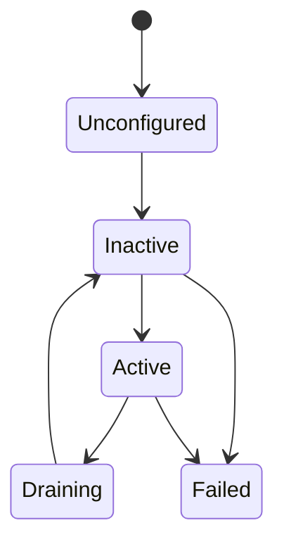

# 状态、故障与生命周期

SDK 把机器人运行时信息分三层暴露：**整机聚合状态**（`robot.state()` / `status()` / `faults()`）、**能力状态袋**（`robot.<slot>.status()`）、**生命周期与健康度**（每个槽位的 `lifecycle()` / `health()`）。三者都是 **GET-only** 的主动查询，没有订阅接口；变化通过事件推送，见 [事件与数据通道](events-channels.md)。

## 整机聚合状态

| 方法 | 返回 | 说明 |
|------|------|------|
| `state()` | `RobotState` | 运行模式、健康度、根因与分域健康 |
| `status()` | `RobotStatus` | 各能力状态袋聚合 + `generation` / `revision` |
| `faults()` | `RobotFaults` | 按槽位聚合的当前故障袋 |
| `version()` | `str` | 机器人平台版本 |
| `sdk_version` | `str` | SDK 自身版本（属性，非方法） |

### RobotState

| 字段 | 类型 | 说明 |
|------|------|------|
| `mode` | `RobotMode` | 运行模式：`Unknown` / `Idle` / `Running` / `Estopped` |
| `health` | `HealthState` | 健康度：`Unknown` / `Normal` / `Degraded` / `Fault` / `Fatal` |
| `root_causes` | `list[DiagnosticReason]` | 健康度不为 `Normal` 时的结构化根因（`code` / `source`）；正常时为空 |
| `domains` | `list[DomainHealth]` | 按域聚合的健康度与根因（`domain` / `health` / `reasons`），按域键排序 |
| `revision` | `int` | 状态修订号 |
| `timestamp_us` | `int` | 最近一次状态或根因变化的时刻（微秒） |
| `source_instance_id` | `str` | 来源实例 id |

便捷属性分两组，分别看两条轴：

| 看运行模式 | 看健康度 |
|------------|----------|
| `is_running` / `is_idle` / `is_estopped` | `is_normal` / `is_degraded` / `is_fault` / `is_fatal` |

运行模式与健康度是独立的：急停只让 `mode` 进入 `Estopped`，`health` 仍由故障与上电自检决定。所以「急停中但健康」`mode == Estopped and health == Normal` 是合法组合。

整机状态变化通过 `robot.events.robot_state_changed` 推送。

```python
st = robot.state()
print(st.mode, st.health)
for cause in st.root_causes:
    print(hex(cause.code), cause.source)
for domain in st.domains:
    print(domain.domain, domain.health)
```

### RobotStatus

| 字段 | 类型 | 说明 |
|------|------|------|
| `generation` | `int` | 状态代际 |
| `revision` | `int` | 状态修订号 |
| `power_1` / `power_2` | `Status` | 电源状态袋，见 [电源 Power](../reference/python/power.md) |
| `head_camera` / `chest_camera` / `waist_camera` / `left_wrist_camera` / `right_wrist_camera` | `Status` | 相机状态袋，见 [相机 Camera](../reference/python/camera.md) |
| `screen` | `Status` | 面屏状态袋，见 [面屏 Screen](../reference/python/screen.md) |
| `voice` | `Status` | 语音状态袋，见 [语音 Voice](../reference/python/voice.md) |

只有提供 `status()` 的能力参与聚合，其余槽位不参与（对应字段保持默认值）。

## 能力状态袋（Status）

提供 `status() -> Status` 的能力：

| 能力 | 状态袋字段 | 参考 |
|------|-----------|------|
| `robot.power_1` / `robot.power_2` | `energy` / `current` / `voltage` / `temperature` / `is_charging` | [电源 Power](../reference/python/power.md) |
| `robot.head_camera` 等 5 个相机 | `state`（`disconnected` / `idle` / `streaming` / `fault`）/ `sync_mode` / `registration_mode` / `color_active` / `depth_active` / `infrared_active` / `imu_active` / `calibration_generation` / `temperature_c` | [相机 Camera](../reference/python/camera.md) |
| `robot.screen` | `activity`：`Activity.Idle` / `Image` / `Video`（StrEnum） | [面屏 Screen](../reference/python/screen.md) |
| `robot.voice` | `activity`：`Activity.Idle` / `Listening` / `Speaking`（StrEnum） | [语音 Voice](../reference/python/voice.md) |

其余模块没有 `status()`，也不参与 `robot.status()` 聚合；它们的状态通过各自的查询方法获取（如灯带用 `light.get_status()`）。

状态袋是 GET-only：没有 `subscribe_status`，跟踪变化请订阅该能力的事件流（相机有 `camera_session_changed`）。

```python
st = robot.power_1.status()
print(st.energy, st.voltage, st.is_charging)

cam = robot.head_camera.status()
print(cam.state, cam.color_active, cam.temperature_c)

act = robot.screen.status().activity
if act == "idle":   # Activity 是 StrEnum，可直接与字符串比较
    ...
```

## 故障（Fault）

- 整机聚合查询 `robot.faults() -> RobotFaults`：`revision` 加上每个槽位一个类型化故障袋字段（如 `faults.chassis`、`faults.left_arm`）；单槽位用 `robot.<slot>.faults()`。
- 故障袋结构统一为 `Faults(revision, records: list[FaultState])`；单条 `FaultState` 为 `code` / `source` / `state` / `severity` / `timestamp_us`。`code` 是诊断码，`0` 表示无故障。
- 故障**变化**通过事件推送：`robot.events.faults_changed`（整机，payload 为按槽位组织的 `RobotFaults`）/ `robot.<slot>.events.fault_changed`（单槽位，payload 为该槽位的 `Faults`）。
- 故障的 `code` 可用 `Catalogs` 本地化展示，见 [文本目录 Catalogs](catalogs.md)。

```python
faults = robot.faults()
for record in faults.chassis.records:
    print(hex(record.code), record.severity, record.timestamp_us)

def on_faults(event):
    print(event.header.timestamp_us, event.faults.revision)

token = robot.events.faults_changed.subscribe(on_faults)
```

:::note 事件 payload 与查询结果形态不同
整机 `faults_changed` 事件的 payload 是类型化的 `RobotFaults`（按槽位分袋）；总线上同一事件的原始 payload 是扁平的 `RobotFaultSnapshot`（`revision` + 故障记录列表）。类型化入口已经替你完成组织，取原始事件自行解码时才需要处理扁平形态。
:::

## 生命周期与健康度

每个槽位有两个只读查询：

- `robot.<slot>.lifecycle() -> CapabilityLifecycleSnapshot`：`lifecycle` / `health` / `pbit_completed` / `source_instance_id`。
- `robot.<slot>.health() -> SlotHealth`：产品层「当前是否可用」视图，字段为 `is_usable` / `lifecycle` / `health` / `standing_faults` / `pbit_completed` / `source_instance_id`。

健康度是**存活、上电自检（PBIT）完成与常驻故障**三者折叠的结果：PBIT 未完成前 `health` 保持 `Unknown`。

`LifecycleState`（IntEnum）：

| 值 | 含义 |
|----|------|
| `Unknown` | 状态未知（未投影到描述符） |
| `Unconfigured` | 已加载但未配置 |
| `Inactive` | 已配置，未激活 |
| `Active` | 正常运行 |
| `Draining` | 正在排空（停止接收新任务） |
| `Failed` | 失败 |

`HealthState`（IntEnum）：`Unknown` / `Normal` / `Degraded` / `Fault` / `Fatal`。



状态迁移由平台按适配器实际运行情况驱动，上图为典型路径；以 `lifecycle()` 返回值与 `lifecycle_changed` 事件的实际值为准。生命周期或健康度变化时推送 `robot.<slot>.events.lifecycle_changed`（payload 为 `CapabilityLifecycleSnapshot`）：

```python
def on_lifecycle(event):
    snap = event.lifecycle
    print(event.header.slot_id, snap.lifecycle.name, snap.health.name, snap.pbit_completed)

token = robot.left_arm.events.lifecycle_changed.subscribe(on_lifecycle)
```

槽位未绑定 adapter 时，`health()` / `lifecycle()` / `faults()` 仍可调用（返回未配置的快照，`health` 为 `Unknown`、`lifecycle` 为 `Unconfigured`），而 `get_config()` 与 `as_adapter()` 会抛 `AdapterUnbound`，能力方法则会下发到平台后失败或超时。先用 `has_adapter` 判断（见 [Robot 入口](../reference/python/robot.md)）。

## 与其他页面的关系

- 整机事件与日志的订阅方式：[事件与数据通道](events-channels.md)
- 日志、指标与冻结快照：[日志、指标与可观测性](observability.md)
- 故障码的本地化文本：[文本目录 Catalogs](catalogs.md)
- 急停后的恢复步骤：[故障排除](../troubleshooting.md)
