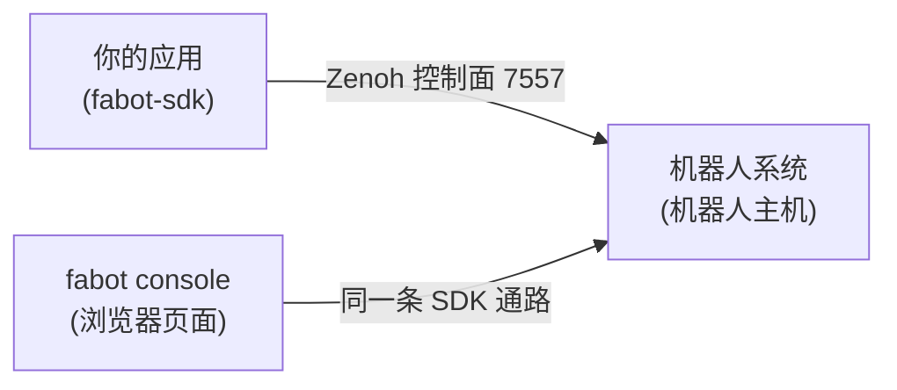

# 机器人系统运维与本地控制台

本页是现场运维入口：机器人主机上运行的那套软件（下称**机器人系统**）提供控制面，SDK 只是连到它的客户端。日常启停、查版本、看日志、打开浏览器控制台都在这里；安装、升级与卸载见 [机器人系统安装与升级](../../getting-started/install/robot-system.md)，参数配置与首次开机配置见 [机器人系统配置](../../getting-started/install/robot-system-config.md)。

## 与 SDK 的关系

- SDK（`fabot-sdk`，导入名 `fabot`）跑在**你的应用进程**里；机器人系统跑在**机器人主机**上，提供控制面（默认端口 7557）。
- `Robot.connect(...)` 建立的就是到机器人系统的连接。能力、技能与平台服务都由机器人系统侧提供，SDK 在应用侧给出强类型代理。
- 两者按**同一产品版本号**配套发布，见 [版本配套](../../getting-started/install/compatibility.md)。



## 通常随机器人预装

机器人系统一般随机器人一起交付：出厂或交付时已安装，并已按机型配好。因此：

- 应用侧一般**不需要自己安装**机器人系统，拿到机器人后直接连接即可。
- 需要重装、升级或换机时，按 [机器人系统安装与升级](../../getting-started/install/robot-system.md) 操作；装完或换机后的参数配置见 [机器人系统配置](../../getting-started/install/robot-system-config.md)。
- 系统由 systemd 单元 `fabot.service` 托管。安装脚本本身不会开启开机自启，出厂是否已 `enable` 取决于交付配置，用 `fabot status` 可以看到当前的 enabled 状态。

## `fabot` 命令

机器人系统装好后提供统一命令 `fabot`，在机器人主机上执行。它只做运维，不替代 SDK；每个命令都有说明页（`fabot help <命令>` 或 `fabot <命令> -h`）。

| 命令 | 作用 |
|------|------|
| `fabot start` / `stop` / `restart` | 启动 / 停止 / 重启机器人系统（`fabot.service`，即整个活动槽位）。`stop` 结束整组进程，SDK 连接随之中断 |
| `fabot status` | 汇总当前状态：版本、活动槽位、`fabot.service` 的 active / enabled、配置覆盖是否就位、各端口是否监听。只读，系统没起来也退出 0 |
| `fabot enable` / `disable` | 打开 / 关闭 `fabot.service` 的开机自启 |
| `fabot doctor` | 逐项检查安装与运行状态，任一项 fail 时退出码为 1，并给出修复命令 |
| `fabot logs [-f]` | 读 `fabot.service` 的 journal |
| `fabot version` | 打印产品根、架构、活动槽位、版本与各命令实际使用的程序路径 |
| `fabot console ...` | 本地控制台，见下节 |

`start` / `stop` / `restart` / `enable` / `disable` 走 systemd；当前用户不是 root 时，命令会先说明要做什么，再让 `sudo` 询问密码。

一个典型的开箱检查：

```console
$ fabot status          # 版本、单元状态、端口监听
$ fabot doctor          # 逐项体检，fail 时给出修复命令
$ fabot logs -f         # 跟随 journal 看启动过程
```

输出里的值随现场变化，这里不贴固定样例。

## `fabot console`

`fabot console` 是机器人系统自带的**本地 Web 控制台**，用浏览器打开机器人地址即可，不需要额外安装客户端。

- 默认监听 `0.0.0.0:8787`，访问 `http://<机器人地址>:8787/`。端口被占用时自动顺延到下一个空闲端口，并在启动输出里说明。
- 顶栏分成整机、坐标系、模块、功能检测、故障排查、演练（Playground）六个页面。整机页看版本、运行模式、连接状态、相机绑定与故障汇总；模块页把能力、技能、服务、环境排在同一页；演练页把 SDK 调用连成流程，可选 mock 或连真机运行。
- 控制台自己也是一个 SDK 应用：它通过 `Robot.from_config()` 连接本机控制面。所以机器人系统没起来时页面仍能打开，只是显示未连接。


*截图取自开发环境；机型、版本、相机绑定等字段随现场变化。*

### 启停控制台

| 命令 | 作用 |
|------|------|
| `fabot console start` / `stop` / `restart` | 启动 / 停止 / 重启 `fabot-console.service`；`start` 与 `restart` 在端口进入监听后打印可访问 URL |
| `fabot console status` | 打印单元的 active / enabled、端口号与监听状态；监听中时列出 URL |
| `fabot console enable` / `disable` | 打开 / 关闭控制台的开机自启（安装后默认关闭） |
| `fabot console` | 不经单元，前台直接提供页面 |
| `fabot console --bind HOST:PORT` | 指定前台监听地址，默认 `0.0.0.0:8787` |

几个容易混的点：

- `fabot console stop` 只停 `fabot-console.service`；用 `fabot console` 前台起的进程不受影响，需要 Ctrl-C 结束。
- 控制台单元不依赖 `fabot.service`：重启机器人系统不会带走控制台，控制台先起来也只是显示未连接。
- 控制台是给人看的运维界面。应用侧要读同样的状态，用 SDK 的 `robot.state()` / `robot.faults()` / `robot.logs` 等接口，见 [状态、故障与生命周期](../data/status-faults.md) 与 [日志、指标与可观测性](../diagnostics/observability.md)。

## 相关页面

- [机器人系统安装与升级](../../getting-started/install/robot-system.md)：安装、升级、回滚与卸载
- [机器人系统配置](../../getting-started/install/robot-system-config.md)：用户配置、端口与环境变量、首次开机配置
- [版本配套](../../getting-started/install/compatibility.md)：两端版本的查看方式与同版本发布的约定
- [连接与 Robot 入口](../basics/connection.md)：`Robot.connect` 与端点选择
- [故障排除](../../troubleshooting.md)：连不上、`wait_ready` 超时
